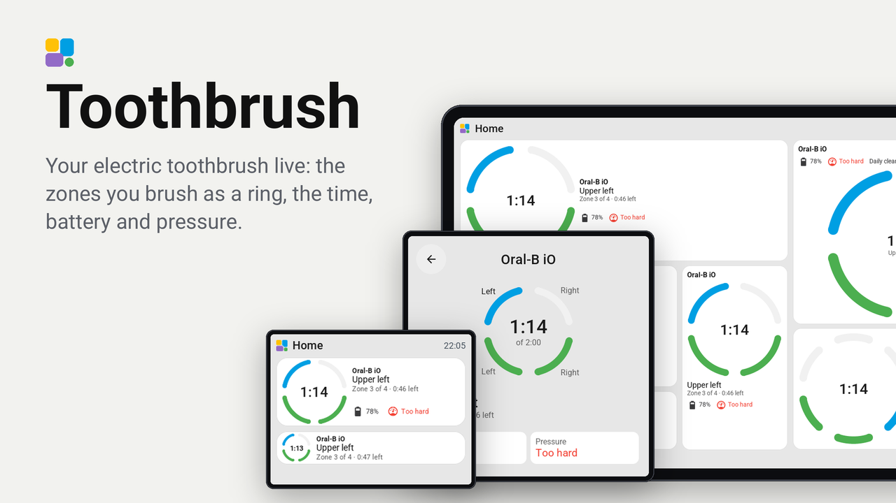
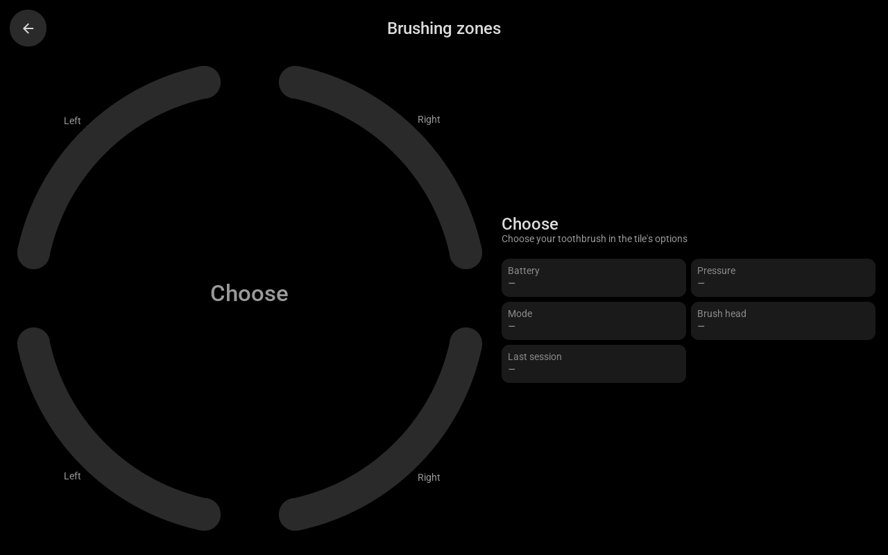

# Toothbrush

Your electric toothbrush live on a Tessera screen. The zones you brush show as a ring around the time: the upper jaw
on top, the lower jaw below, a zone done in green and the one you brush now in the accent. Battery, pressure and mode
sit beside it, and a tap opens the whole session over the page.

It works with the toothbrushes Home Assistant knows over Bluetooth: Oral-B (`oralb`, `oralb_live`), Philips Sonicare
(`philips_sonicare_ble`), Xiaomi (`xiaomi_ble`) and Laifen (`laifen_ble`). It is a Tessera version of
[toothbrush-card](https://github.com/mtheli/toothbrush-card) by mtheli, whose zone and session logic it follows.

## Set up

It needs a Tessera with plugin API 0.15: Tessera's dev branch until its next release.

1. In Tessera, open Plugins, choose **Add with a link** and paste this repository's link.
2. Tick the screen in the bathroom and apply. The screen builds once.
3. In Layout, place the **Toothbrush** tile from the library's Plugins group, at any size from 1x1 to 4x4.
4. In the inspector, choose the brush's entities. Only **Toothbrush** is needed; each other one adds its reading:

   | Option | Oral-B (`oralb`, `oralb_live`) | Sonicare (`philips_sonicare_ble`) | Laifen (`laifen_ble`) | Xiaomi (`xiaomi_ble`) |
   |---|---|---|---|---|
   | Toothbrush | `…_toothbrush_state` | `…_handle_state` | `…_status` | `…_toothbrush` |
   | Zone | `…_sector` | `…_sector` | leave empty | leave empty |
   | Brushing time | `…_time` | `…_brushing_time` | `…_timer` | leave empty |
   | Battery | `…_battery` | `…_battery` | `…_battery` | `…_battery` |
   | Pressure | `…_pressure` | `…_pressure_state` | `…_pressing_too_hard` | leave empty |
   | Mode | `…_mode` | `…_brushing_mode` | `…_mode` | leave empty |
   | Brush head | `…_refill_days` | brush head wear (its brush head device) | leave empty | `…_consumable` |
   | Last session | `…_last_session` | `…_last_session` | leave empty | `…_score` |

   The lists are searchable: type the brush's name. Another choice shows at once, without a build.
5. Check the other options: the number of zones (Auto, 4 or 6), the length of your routine, how long the result
   stays, and what the brush head counts (days, percent or sessions).

## What it shows

- **1x1**: the ring with the time in its middle.
- **2x1 and wider**: the ring on the left; the zone, how far you are and the chips on the right.
- **1x2 and taller**: the ring on top; the zone, how far you are and the chips under it.
- **2x2 and up**: the name, battery, pressure and mode, and a large ring.
- **A tap**: the full-screen card, with every zone named around the ring and every reading.

After a session the ring stays green for as long as you chose ("Done"), or shows how far you got ("Stopped early").

The full-screen card on a 10-inch screen, in the middle of a six-zone session:

Every tile at every size on every screen, drawn by the real firmware on Tessera's preview bench, is in
[renders/](renders/) ([overview](renders/overview.png)): one folder per screen, light and dark, with the finest grid of
each in a folder of its own.

## Good to know

- Tessera sends the entities you choose to the screen and follows them. Nothing is needed in Home Assistant: no
  template, no helper, no integration of its own.
- Each tile has its own brush, so a screen can show several: one tile each.
- A brush without a zone sensor (Xiaomi, Laifen) gets its zones by time, evenly over the routine.
- Auto zones show 4 until the brush reports a fifth zone; choose 6 for a brush that brushes in six from the start.
- Tried on: Tessera's preview bench (the CYD, the Guition 4-inch, the Waveshare 4.3-inch standing up and the Guition
  10.1-inch), not yet on a real screen with a real brush. Please say in an issue which board and brush you used.

## Privacy

It talks to nothing outside your home: Tessera sends the screen the states of the entities you chose in the tile's
options, from your Home Assistant.
